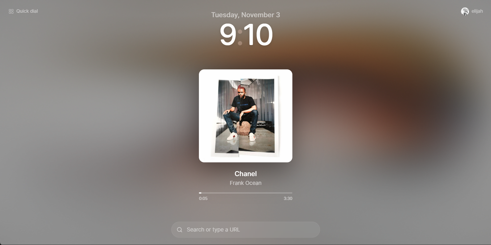

Jukebox
=======

A new tab extension that shows what you're listening to on Spotify. It has a clock, a search bar
and a few quick links, and the background is an animated blur of the current
album art.



## Features

- **Now playing:** current track, artist and a live progress bar
- **Two sources:** either sign in with Spotify, or just enter a Last.fm username to
  use your scrobbles instead
- **Recently played:** shows your 5 recently played songs, can be disabled in settings
- **Animated background:** Done via
  [Kawarp](https://www.npmjs.com/package/@kawarp/core). It can be turned off
  in settings
- **Search:** Google suggestions as you type, plus bangs: `!g`, `!yt`, `!sp`
  (Spotify) and `!gh`
- **Quick dial:** Up to five links you can edit in place
- **Clock:** 12 or 24 hour format, with an optional date

## Setup

You need [Bun](https://bun.sh) and a Chromium browser (Chrome, Edge, Brave,
Helium…).

```sh
bun install
```

Create a `.env` file in the project root:

```sh
WXT_SPOTIFY_CLIENT_ID=your-spotify-client-id
WXT_LASTFM_API_KEY=your-lastfm-api-key
```

### Spotify

I would submit this to the Chrome Web Store but that means I'd have to get accepted to let anyone log in to my Spotify app but they've limited that to organizations now, so you'll have to do it yourself.

1. Create an app in the
   [Spotify developer dashboard](https://developer.spotify.com/dashboard) and
   copy its client ID.
2. Add this redirect URI to the app:

   ```
   https://fmadgabodjggpkfmhgafikahcniopdaa.chromiumapp.org/
   ```

   The extension ID is fixed by the public key in `keys/public-key.txt`, so
   this URI is the same on every machine.

Sign-in uses PKCE, so there is no client secret. The extension asks only for
read access: `user-read-currently-playing`, `user-read-playback-state` and
`user-read-recently-played`.

> Spotify apps in development mode only work for users you add under
> **User Management** in the dashboard.

### Last.fm

Get an API key from [Last.fm](https://www.last.fm/api/account/create). No
sign-in is needed. You just type a username.

## Development

```sh
# Install deps
bun install
# Starts a browser with hot reload
bun run dev
# Builds the project
bun run build
# Builds and zips
bun run zip

# Tests/Checks
bun run compile
bun run lint
```

To load a build by hand, open `chrome://extensions`, turn on
**Developer mode**, click **Load unpacked** and pick `.output/chrome-mv3`.

The Firefox scripts (`dev:firefox`, `build:firefox`, `zip:firefox`) build, but
Spotify sign-in is only set up for Chromium.

## Permissions

| Permission                   | Used for                                 |
| ---------------------------- | ---------------------------------------- |
| `identity`                   | Spotify sign-in                          |
| `storage`                    | Settings, quick links and cached tracks  |
| `search`                     | Searching with your default search engine |
| `favicon`                    | Icons for quick dial links and bangs     |
| `suggestqueries.google.com`  | Search suggestions                       |

## Built with

Track data comes from Spotify and [Last.fm](https://www.last.fm). This project
is not affiliated with either.
